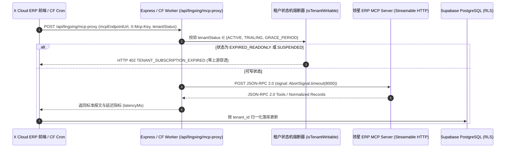

# 01. 核心基础设施与上游领星 MCP 同步域 (`01-core-infra-and-sync`)

## 1. 适用场景声明
当修改或排查以下目录与文件时，**必读本篇**：
- `/server.ts`（Express 4 全栈开发与边缘协议代理网关）
- `/src/services/supabaseClient.ts`（Supabase 客户端全局单例池、URL 自动规范化与双模认证配置存储）
- `/src/services/erpDatabaseService.ts`（全量 24 类 ERP 与多租户实体直连 Supabase 读写与增量同步仓库层）
- `/src/services/lingxingMcpSync.ts`（领星 MCP 真实报文解包、Schema 驱动参数构造与店铺/ASIN/订单/广告/财务归一化引擎）
- `/src/components/LingxingMcpConnectorView.tsx`（领星 MCP 上游接入、一键全量真实同步落库与 JSON-RPC 观测视图）
- `/src/components/SupabaseSetupModal.tsx`（平台超管专属 Supabase 与双模认证配置弹窗）
- `/src/data/initialErpData.ts` 中的 `SUPABASE_MULTI_TENANT_SQL_SCHEMA`、`CLOUDFLARE_WORKER_DEPLOY_CODE` 与 `WRANGLER_TOML_CONFIG`

---

## 2. 第一性原理推导 (First-Principles Derivation)
1. **为什么用领星 MCP 替代亚马逊 SP-API + Advertising API**：
   - 亚马逊原生 SP-API 需要 AWS IAM Role + SigV4 签名 + LWA OAuth + 审核周期，且多店铺与广告报表分散在两套独立 API 中；而领星 ERP MCP 通过统一的 **Streamable HTTP JSON-RPC 2.0 + `X-Mcp-Key`** 封装了店铺、Listing、FBA 库龄、广告小时级与多维利润视图，无需固定出口 IP 白名单，从通信协议第一性原理上兼容 Cloudflare Workers 无服务器动态出口 IP 架构。
2. **为什么所有外部 `fetch` 必须绑定刚性超时 (`AbortSignal.timeout`)**：
   - 在 Node.js 单线程事件循环与 Cloudflare Workers 有限 CPU/连接池模型中，若上游第三方 HTTP 响应进入半开 TCP 挂起状态而无超时上限，将导致连接句柄泄漏与请求雪崩。根据排队论（Little's Law $L = \lambda W$），锁定最大等待时间 $W \le 8000\text{ms}$ 是保障系统吞吐与可预测尾延迟的必要条件。
3. **为什么在边缘代理层前置校验 `EXPIRED_READONLY` / `SUSPENDED`**：
   - 订阅到期后若继续由 Cron 或前端代理向上游领星 MCP 拉取数据，将持续消耗平台边缘计算额度与上游速率配额。在代理入口即刻返回 HTTP `402 Payment Required` 实现“零上游穿透熔断”。

---

## 3. 总体架构拓扑与核心数据流



| 分层 | 核心文件 | 职责边界 |
| --- | --- | --- |
| 网关与代理层 | `server.ts` | 绑定 Port `3000`，提供 `/api/lingxing/mcp-proxy` 与 `/api/mcp`，承载 Vite 开发中间件或生产静态资源 |
| 客户端连接与持久层 | `src/services/supabaseClient.ts`、`src/services/erpDatabaseService.ts` | 全局单例池防多 `GoTrueClient` 冲突、URL 自动剥离 `/rest/v1/`，并通过 `erp_domain_records` + `sys_tenants` 承担全量业务实体真实读写，严禁前端运行时回退硬编码假数据 |
| 边缘定时同步层 | `CLOUDFLARE_WORKER_DEPLOY_CODE` | 负责 Cloudflare Cron (`*/15 * * * *`) 定时扫描活跃租户并拉取领星 MCP |

---

## 4. 详细设计方案与代码契约
1. **服务端口监听契约**：`server.ts` 必须通过 `const PORT = Number(process.env.PORT) || 3000;` 监听 `0.0.0.0:3000`，匹配预览容器与反向代理端口约定。
2. **外部调用超时契约**：任何调用外部 `fetch(url, init)` 的服务端/Worker 代码必须显式传入 `signal: AbortSignal.timeout(8000)`（上限不超过 15000ms）。
3. **租户可写判断函数 (`src/lib/erpEngine.ts`)**：
   ```ts
   export function isTenantWritable(tenant: Pick<Tenant, 'subscriptionStatus'>): boolean
   ```
   仅当状态为 `ACTIVE`、`TRIALING`、`GRACE_PERIOD` 时返回 `true`。
4. **大表全页拉取与长周期分段订单同步契约 (`src/services/lingxingMcpSync.ts`, `src/services/erpDatabaseService.ts`)**：
   - `batch_inventory_statement_list` (`WAREHOUSE_LEDGERS`) 使用基于单据/批次/时间/方向/结存的多字段复合事件签名 (`recordSignature(..., 'WAREHOUSE_LEDGERS')`)，避免同 SKU/同仓库流水在分页汇总或归一化时被折叠；`collectAllPaginatedRecords` 结合 `upstreamTotal / effectivePageSize` 动态扩展页数上限（最高 `ABSOLUTE_MAX_PAGES_CEILING = 250`），且 `erpDatabaseService.ts` 分页读写支持最高 150,000 行。
   - `amazon_sales_order_list` (`ORDERS`) 支持 `31 / 90(默认) / 180 / 365` 天同步跨度，通过 `buildDateWindowChunks` 与 `collectChunkedDateRangeRecords` 按 30 天由近及远分段全页拉取并去重汇总；执行较短日期窗口同步时，数据库与前端状态按 `orderWindowStartDate` 仅清理窗口内陈旧 `lx-*` 订单，完整保留窗口之前的历史订单。
5. **停用浏览器 `localStorage` 数据库配置持久化契约 (`src/services/supabaseClient.ts`, `server.ts`)**：
   - 前端全面禁止对 `xcloud_erp_supabase_config_v1` 执行 `localStorage.getItem` / `localStorage.setItem`，并在加载与更新时自动调用 `clearLegacyBrowserSupabaseConfig()` 清除历史残留键。
   - 数据库连接配置统一由 Express 服务端 `/api/platform/db-config` 托管：优先读取服务端运行内存覆盖（供超管临时切换调试，不写入磁盘明文文件），默认读取服务端环境变量 `SUPABASE_URL` / `SUPABASE_ANON_KEY`（兼容 `VITE_SUPABASE_*`），且永不向前端暴露 `SUPABASE_SERVICE_ROLE_KEY`。
6. **领星 MCP 混合增量同步与租户水位线契约 (`src/services/lingxingMcpSync.ts`, `src/services/lingxingAutoSyncRunner.ts`, `src/components/LingxingMcpConnectorView.tsx`)**：
   - 所有租户按同步域在 `Tenant.lingxingSyncWatermarks` 中持久化水位线（存于 Supabase 租户 JSON 载荷，无需修改表结构）；当某域首次同步或本地为空 (`existingDomainCount === 0`) 时，`resolveIncrementalSyncPlan` 自动升级为全量初始化回溯 (`FULL_SNAPSHOT`)。
   - **3 个经在线实测支持原生 `update_time` 过滤的接口**：
     - `batch_inventory_statement_list` (`WAREHOUSE_LEDGERS`)：`time_filter_field: 'update_time'`、`start_date`、`end_date`；
     - `get_delivery_order_list` (`FBA_SHIPMENTS`)：`time_type: '3'`、`start_date`、`end_date`、`sort_field: 'update_time'`、`sort_type: 'desc'`；
     - `warehouse_processing_order_list` (`BOM_ORDERS`)：`search_field_time: 'update_time'`、`start_date`、`end_date`。
     上述接口在增量模式下强制标记 `preserveExistingOutsideDelta = true`，严禁进入 `pruneStaleDomains` 裁剪清单，避免增量结果覆盖删除未变更的历史记录。
   - **亚马逊订单 (`amazon_sales_order_list`) 混合增量策略**：因领星该接口 `additionalProperties: false` 且仅支持下单日期区间 (`startDate`/`endDate`)，日常增量拉取采用 `max(7, daysSinceWatermark + 7)` 天回溯窗口（保护窗口之前历史订单不删），并经由 `collectPendingOrderRefreshRecords` 抽取窗口外历史 `PENDING` 订单（排除 `MCF-*`），按每批 50 单调用 `searchField: 'amazonOrderId'` + `exactSearch: 1` 批量精确复查最新状态 (`SHIPPED`/`CANCELED`)。
   - 手动一键同步、单工具同步及服务端定时调度 (`/api/lingxing/scheduler/configure` & `/trigger`) 统一默认 `syncMode: 'INCREMENTAL'`，并允许按需切换为 `FULL` 全量回溯。
7. **后端托管按需分页面加载与大表真分页查询契约 (`src/services/backendDataEngine.ts`, `src/services/backendDataClient.ts`, `server.ts`, `src/App.tsx`)**：
   - **零启动加载屏**：系统启动仅静默调用 `GET /api/erp/bootstrap` 获取 7 张极轻量外壳/权限表（`plans`, `tenants`, `rbacRoles`, `teamMembers`, `appModules`, `installedModules`, `shops`），严禁启动阶段全量拉取 `orders`/`listings`/`warehouseLedgers`/`searchTerms` 或渲染「正在从 Supabase 实时数据库加载...」遮罩。
   - **按页面按需拉取**：打开或切换任意页面时，仅依据严格白名单 `PAGE_ENTITY_REQUIREMENTS[pageId]` 调用 `POST /api/erp/page-data` 拉取当前页所需最小数据集（`overview` 订单按近 70 天裁剪、`product_performance` 按近 100 天裁剪、`lingxing` 仅拉取 `PENDING` 订单与各域精确计数）。
   - **大表真后端分页**：亚马逊订单与 Listing (`AmazonOrdersAndListingsView`)、仓库库存流水 (`WarehouseInventoryView`)、广告搜索词 (`AdvertisingDaypartingView`) 在打开、翻页、切换每页条数、搜索与筛选时真实触发 `POST /api/erp/query`，由后端执行租户隔离、非管理员店铺白名单隔离 (`allowedShopIds`)、统计汇总与切片返回，并配合 30 秒短 TTL 缓存及写操作后的 `POST /api/erp/cache/invalidate` 保持一致性。
8. **Cloudflare Workers 全栈资产部署契约 (`wrangler.toml`, `worker.ts`)**：
   - 根目录 `wrangler.toml` 声明 `name = "xclouderp"`、`main = "worker.ts"`、`compatibility_flags = ["nodejs_compat"]`，以及 `[assets]`（`directory = "./dist"`、`binding = "ASSETS"`、`not_found_handling = "single-page-application"`、`run_worker_first = ["/api/*"]`）与 `[triggers]` 定时任务，确保 Cloudflare 将应用部署为 **带静态资产的完整 Worker** 而非仅静态资产 Worker，从而支持在 Cloudflare Dashboard (`Settings -> Variables and Secrets`) 中自由配置环境变量与密钥。
   - `worker.ts` 完整实现全部 `/api/*` 路由（`/api/health`、`/api/platform/db-config`、`/api/erp/*`、`/api/lingxing/mcp-proxy`、`/api/lingxing/scheduler/*`、`/api/mcp`）、`scheduled()` 定时同步与 `env.ASSETS.fetch()` 前端静态回落，严格执行 `AbortSignal.timeout`、外网 HTTPS 校验、HTTP 402 熔断与 `PLATFORM_SUPER_ADMIN` 隔离，且绝不向前端暴露 `SUPABASE_SERVICE_ROLE_KEY`。

---

## 5. 接口详细文档 (API & Data Contracts)

### `POST /api/lingxing/mcp-proxy`
- **鉴权要求**：请求体需提供租户级 `mcpEndpointUrl`、`mcpApiKey` 与 `tenantStatus`（生产环境由服务端从 Supabase 查出，防止客户端伪造）。
- **Request Payload Schema**：
  ```json
  {
    "mcpEndpointUrl": "https://mcp.lingxing.com/mcp/v1/stream",
    "mcpApiKey": "lx_mcp_demo_****",
    "jsonRpcMethod": "tools/list | tools/call",
    "toolName": "lx_query_asin_daily_sales",
    "toolArgs": { "days": 30 },
    "tenantStatus": "ACTIVE | TRIALING | GRACE_PERIOD | EXPIRED_READONLY | SUSPENDED"
  }
  ```
- **Response JSON (`200 OK`)**：
  ```json
  {
    "ok": true,
    "latencyMs": 124,
    "endpoint": "https://mcp.lingxing.com/mcp/v1/stream",
    "requestPayload": { "jsonrpc": "2.0", "method": "tools/call" },
    "responsePayload": { "jsonrpc": "2.0", "result": {} }
  }
  ```
- **错误码字典**：
  - `400 MISSING_LINGXING_CREDENTIALS`：缺少 `mcpEndpointUrl` 或 `mcpApiKey`。
  - `402 TENANT_SUBSCRIPTION_EXPIRED`：租户处于 `EXPIRED_READONLY` 或 `SUSPENDED`，已熔断上游同步。

### `GET / POST /api/platform/db-config`
- **鉴权与安全要求**：
  - `GET /api/platform/db-config` 返回当前生效的公开连接参数（`projectUrl`, `anonKey`, `authMode`, `logtoEndpoint`, `logtoAppId`）及 `configSource` (`ENV | SERVER_MEMORY | UNCONFIGURED`)，绝不返回 `SUPABASE_SERVICE_ROLE_KEY`。
  - `POST /api/platform/db-config` 仅允许 `portalMode === 'PLATFORM_SUPER_ADMIN'` 调用（非超管返回 HTTP `403 SUPER_ADMIN_ONLY`），并对 `projectUrl` 与 `logtoEndpoint` 强制执行 `validateSafeExternalMcpUrl` 外网 HTTPS 校验；写入仅存于服务端运行内存，不落盘明文文件、不写入浏览器 `localStorage`。

### `GET /api/erp/bootstrap`、`POST /api/erp/page-data`、`POST /api/erp/query`、`POST /api/erp/cache/invalidate`
- **`GET /api/erp/bootstrap`**：静默返回外壳与权限元数据（`BOOTSTRAP_ENTITY_TYPES`）及数据库连接状态，不拉取任何重业务表。
- **`POST /api/erp/page-data`**：根据白名单校验后的 `pageId` 与 `tenantId` 仅加载当前页面所需实体数据与必要计数；非法 `pageId` 返回 HTTP `400`。
- **`POST /api/erp/query`**：根据白名单校验后的 `entityType` (`ALLOWED_QUERY_ENTITIES`)、`tenantId`、`roleCode`、`allowedShopIds`、`page`、`pageSize`（后端强制夹紧 `[5, 200]`）、`search`、`filters` 执行服务端隔离筛选、精确聚合与当前页切片返回；非法实体类型返回 HTTP `400`。
- **`POST /api/erp/cache/invalidate`**：写操作、领星同步或切换数据库配置后失效对应实体的服务端短 TTL 缓存。

---

## 6. 历史故障与对抗挑刺规则索引 (`scripts/audits/01-core-infra-and-sync.audit.ts`)

| 规则 / 测试 ID | 挑刺检查目标 | 历史故障根因与防重契约 |
| --- | --- | --- |
| `INFRA-ADV-01` | 检查 `server.ts` 及 Cloudflare Worker 模板中所有外部 `fetch(` 是否配置 `AbortSignal.timeout` / `signal` | 防止领星远端网络波动导致 Express 句柄堆积或 Cloudflare Worker 触发 30s CPU 超时雪崩 |
| `INFRA-ADV-02` | 检查 `server.ts` 中 `/api/lingxing/mcp-proxy` 是否显式校验 `EXPIRED_READONLY` / `SUSPENDED` 并返回 HTTP `402` | 防止已到期卖家租户继续穿透代理消耗上游领星配额与边缘计算资源 |
| `INFRA-ADV-03` | 检查 `src/services/supabaseClient.ts` 不得硬编码真实 `https://*.supabase.co` 项目 URL 或真实 `eyJhbGci` Anon Key | 防止开发者调试时将个人数据库凭据提交至源码仓库造成跨环境串库泄漏 |
| `INFRA-ADV-04` | 检查 `server.ts` 必须显式绑定端口 `3000` 并监听 `0.0.0.0` | 防止修改监听端口导致预览网关 502 Bad Gateway |
| `INFRA-ADV-05` | 校验 `supabaseClient.ts` 提供 `normalizeSupabaseProjectUrl` 与全局单例池（防多 `GoTrueClient` 警告），且 `src/App.tsx` 运行时直连 `loadErpDatabaseSnapshot` 而非硬编码 `INITIAL_TENANTS` | 防止误粘贴 `/rest/v1/` 导致连接失败、防止反复探测产生多个 `GoTrueClient` 实例、并杜绝前端静默展示代码演示数据导致领星配置等修改无法落库持久化 |
| `INFRA-ADV-06` | 校验 `server.ts` 对外部 MCP URL 强制执行 HTTPS 外网校验 (`validateSafeExternalMcpUrl`) 与 SSE 解析 (`parseMcpResponseBody`)、严禁残留假数据兜底 (`buildStandardLingxingMcpResponse`)，且具备 `lingxingMcpSync.ts` 与 `persistLingxingSyncedEntities` 真库同步管线 | 防止代理路由被滥用探测内网/元数据地址、防止上游报错被假数据掩盖、并确保领星 MCP 拉取的真实店铺/ASIN/订单直接归一化持久化至 Supabase |
| `INFRA-ADV-07` | 校验 `server.ts` 挂载 `/api/lingxing/scheduler/*` 与 `src/services/lingxingAutoSyncRunner.ts` 定时自动同步引擎，且业务组件严禁残留 `B00DEMO001` / `X000DEMO01` / `Store-Alpha-` / `XC-PRO-365D-DEMO-0001` 虚拟兜底值 | 防止仅存在静态 Cron 代码模板却未真实启动定时同步，并杜绝业务表单在同步真实领星数据后仍回退展示虚拟样例 |
| `INFRA-ADV-08` | 校验 `src/types/erp.ts` 定义 `CurrencyCode` 且 `MarketplaceCode` 包含 `MX`/`BR`，并校验 `src/services/lingxingMcpSync.ts` 注册第 12 域 `warehouse_processing_order_list` (`BOM_ORDERS`)、`normalizeLingxingBomOrders` 与 `getCurrencyIcon` | 防止墨西哥/巴西站点被强行折叠为 US/USD、防止日元/比索等本地货币在前端误显示为 `$`，并确保领星 BOM 加工单纳入全量 12 域同步与落库 |
| `INFRA-ADV-09` | 校验 `src/services/lingxingMcpSync.ts` 导出 `collectAllPaginatedRecords` 与 `extractTotalCountFromMcpResult`、`src/services/lingxingAutoSyncRunner.ts` 调用全页分页拉取、且 `src/services/erpDatabaseService.ts` 使用 `.range()` 循环读取替代单次 `.limit(5000)`；内存注入验证 250 条 ASIN 自动步长校准与重复页熔断 | 防止领星多页接口仅拉取第 1 页导致 ASIN 截断在 100 条（采购/广告/结算截断在 50 条），并突破 Supabase PostgREST 单次查询 1,000 行静默截断限制 |
| `INFRA-ADV-10` | 校验 `src/lib/erpEngine.ts` 导出 `calculateLingxingWindowSales`、`DashboardOverview.tsx` 接入订单实算引擎、`lingxingMcpSync.ts` 使用稳定主键 `lx-ord-${tenantId}-${amazonOrderId}` 并拆分 `CANCELED` 状态、`erpDatabaseService.ts` 支持 `pruneStaleDomains` 清理陈旧 `lx-*` 记录；内存注入验证昨日订单量(单)与总销量(件)分离、取消单剔除、多币种折算 USD 与重复单去重 | 防止首页用 `listings.yesterdayVolume`（销量件数/陈旧快照）冒充昨日订单量、防止未剔除 `Canceled` 与未折算 JPY/MXN 导致与领星后台昨日订单数据对不上，并根治 Pending 订单下标变动引发的重复入库 |
| `INFRA-ADV-11` | 校验 `src/services/lingxingMcpSync.ts` 导出 `buildDateWindowChunks` / `collectChunkedDateRangeRecords` / `recordSignature` 与 `ABSOLUTE_MAX_PAGES_CEILING`、`lingxingAutoSyncRunner.ts` 与 `LingxingMcpConnectorView.tsx` 接入 `orderSyncDays` 分段订单同步、`erpDatabaseService.ts` 支持 `orderWindowStartDate` 历史订单窗口保护；内存注入验证 350 条同 SKU 库存流水零折叠全量归一化、180 天分段切片与窗口外历史订单防误删 | 根治 `batch_inventory_statement_list` 因 `msku|wh_id` 签名碰撞与 30 页封顶导致 6,155 条流水折叠截断为 308 条的问题，并实现 `amazon_sales_order_list` 90/180/365 天长周期分段全量同步且在窄窗口增量同步时保护历史订单 |
| `INFRA-ADV-12` | 校验 `src/services/supabaseClient.ts` 零 `localStorage.getItem/setItem` 调用且导出 `clearLegacyBrowserSupabaseConfig` / `fetchServerSupabaseConfig` / `saveServerSupabaseConfig`、`server.ts` 挂载受 `PLATFORM_SUPER_ADMIN` 与 `validateSafeExternalMcpUrl` 保护的 `GET/POST /api/platform/db-config` 且严禁暴露 `SUPABASE_SERVICE_ROLE_KEY`；内存注入验证读写配置全程零 `localStorage` 存取并主动清理旧键 `xcloud_erp_supabase_config_v1` | 彻底停用浏览器 `localStorage` 保存数据库配置，避免凭据绑定单台浏览器、清缓存失效或在浏览器持久留存，并统一收敛至服务端环境变量与运行内存托管 |
| `INFRA-ADV-13` | 校验 `src/services/lingxingMcpSync.ts` 导出 `resolveIncrementalSyncPlan` 与 `collectPendingOrderRefreshRecords` 及 3 个原生 `update_time` 参数与 `exactSearch: 1`、`lingxingAutoSyncRunner.ts` / `LingxingMcpConnectorView.tsx` / `App.tsx` 接入混合增量策略与 `lingxingSyncWatermarks` 水位线落库并保护 `preserveExistingOutsideDelta` 域不被裁剪、`server.ts` 透传 `syncMode`；内存注入验证空库降级全量、3 个 `update_time` 增量参数、订单回溯缩窗与窗口外 `PENDING` 单批量精确复查 | 实现经领星 OpenMCP 在线实测验证的混合增量同步体系，大幅降低日常高频同步的翻页与数据库写入负载，同时杜绝增量同步误删历史流水/发货单/加工单或漏更新跨周期 `PENDING` 订单状态 |
| `INFRA-ADV-14` | 校验 `server.ts` 挂载受 `PAGE_ENTITY_REQUIREMENTS` / `ALLOWED_QUERY_ENTITIES` 保护的 `/api/erp/bootstrap`、`/api/erp/page-data`、`/api/erp/query` 与 `/api/erp/cache/invalidate`、`src/App.tsx` 移除启动全量加载遮罩并接入按需分页面加载与 `backendQueryContext`、`AmazonOrdersAndListingsView` / `WarehouseInventoryView` / `AdvertisingDaypartingView` 接入 `queryErpPagedData`；内存注入验证引导与大表页面不泄漏重表及后端分页查询的租户/店铺隔离、取消单剔除与精确汇总 | 彻底解决进入系统全量拉取 26 张表并弹出加载遮罩、大表翻页仅切前端本地内存的问题，实现全站静默进入、各页面按需拉取与大表真实后端分页查询 |
| `INFRA-ADV-15` | 校验根目录 `wrangler.toml` 声明 `main = "worker.ts"` 与 `[assets]` (`directory = "./dist"`, `binding = "ASSETS"`, `run_worker_first = ["/api/*"]`) 且无硬编码密钥、`worker.ts` 完整覆盖 `/api/*` 路由、`AbortSignal.timeout`、`validateSafeExternalMcpUrl`、`PLATFORM_SUPER_ADMIN`、不引用 `SUPABASE_SERVICE_ROLE_KEY` 及 `env.ASSETS.fetch` 回落；内存注入验证 Cloudflare `env` 读取与高危密钥不泄漏及 403/402/400/静态资源委派行为 | 解决部署到 Cloudflare Workers 时因缺少 Worker 入口脚本导致系统被识别为“只有静态资产的 Worker”而报错“不能将变量添加到只有静态资产的 Worker”及 `/api/*` 接口失效的问题 |
