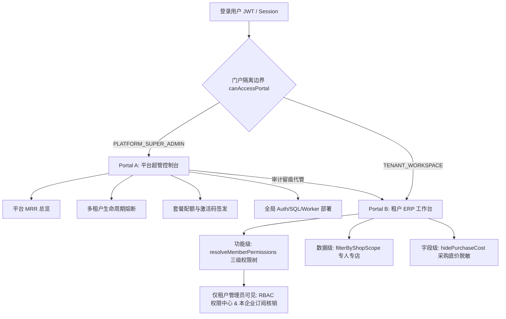

# 02. 多租户数据库、双模认证与企业 RBAC 权限域 (`02-db-auth-and-rbac`)

## 1. 适用场景声明
当修改或排查以下目录与文件时，**必读本篇**：
- `/src/types/erp.ts`（`PortalMode`, `PermissionCode`, `RbacRoleDefinition`, `RbacTeamMember`, `Tenant`, `TenantIsolationMode`, `ErpAppModule`, `TenantInstalledModule`, `TenantInvitation`, `ImpersonationSession`, `TenantWorkspaceSettings`）
- `/src/lib/erpEngine.ts`（`canAccessPortal`, `resolveMemberPermissions`, `hasPermission`, `filterByShopScope`, `checkTenantQuota`, `validateTenantSlug`, `resolveTenantByPathSlug`, `canTenantInstallModule`, `isModuleEnabledForTenant`, `generateTenantSchemaSql`, `isValidImpersonationSession`）
- `/src/components/SuperAdminConsoleView.tsx`（Portal A：平台超管控制台 · 含自动化开户向导、中央应用市场目录、全局数据库与认证引擎/BYOD 库托管）
- `/src/components/SupabaseSetupModal.tsx`（Portal A 专属：平台超管全局数据库与双模认证配置弹窗）
- `/src/components/RbacPermissionCenterView.tsx`（Portal B：租户管理员 RBAC 权限中心与团队入驻邀请）
- `/src/components/TenantSubscriptionView.tsx`（Portal B：租户自助订阅与激活码核销）
- `/src/components/TenantAppMarketplaceView.tsx`（Portal B：租户应用市场模块按需启停）
- `/src/components/TenantWorkspaceSettingsView.tsx`（Portal B：租户轻量白标与只读隔离状态快照）
- `/src/components/LoginGateView.tsx`（全站登录验证门禁与首次启动管理员初始化视图）
- `/src/services/authService.ts`（跨 Node.js / Cloudflare Workers Web Crypto 登录认证、PBKDF2 密码哈希与 HMAC-SHA256 签名会话引擎）
- `/src/services/authClient.ts`（浏览器纯内存态 Bearer Token 客户端，禁用 `localStorage`/`sessionStorage`）
- `/src/data/initialErpData.ts` 中的 `ALL_PERMISSIONS_TREE`、`INITIAL_RBAC_ROLES`、`INITIAL_APP_MODULES`、`INITIAL_INSTALLED_MODULES`、`INITIAL_INVITATIONS`、`SUPABASE_MULTI_TENANT_SQL_SCHEMA`

---

## 2. 第一性原理推导 (First-Principles Derivation)
1. **为什么必须将平台超管 (Portal A) 与卖家租户工作台 (Portal B) 物理隔离**：
   - 权限边界的本质是 **信息流隔离（Non-Interference）**。若将“全平台租户列表、四级套餐改价、激活码签发”与“单个卖家的亚马逊 ERP 业务”混置在同一侧边栏组件中，任何一次条件渲染遗漏都会导致越权信息泄露（Horizontal / Vertical Privilege Escalation）。独立路由与独立组件从结构上消除误渲染风险。
2. **为什么采用「功能权限树 + 数据店铺范围 + 字段脱敏」三维 RBAC 模型**：
   - 跨境卖家组织天然存在“专人专店（北美运营不能看欧洲站营收）”与“成本保密（运营人员不能看 1688 采购底价）”两大刚需。仅靠菜单开关无法防止数据越权，必须在纯函数层 (`filterByShopScope`) 与数据库内核层 (`ENABLE ROW LEVEL SECURITY` + `allowed_shop_ids`) 双重收口。
3. **为什么同时兼容 Supabase Auth 与 Logto OIDC**：
   - MVP 与零成本自托管阶段，Supabase Auth 与 PostgreSQL RLS 零延迟原生打通；随着 B2B 大卖租户需要多组织 (Organizations)、企业微信/SAML SSO 与下游 MCP OAuth 2.1 动态注册，Logto OIDC 提供平滑无损演进路径。

---

## 3. 总体架构拓扑与核心数据流

| 角色层级 | 归属门户 | 允许操作范围 | 严禁越权边界 |
| --- | --- | --- | --- |
| `PLATFORM_SUPER_ADMIN` | Portal A | 全局租户启停、四级套餐配额定价、激活码签发、全局数据库/BYOD 实例绑定与双模登录认证引擎 (`Supabase Auth`/`Logto OIDC`) 运维 | 不在超管菜单直接混入卖家日常 ERP 单据操作与租户领星 MCP 密钥 |
| `TENANT_ADMIN` | Portal B | 本租户全模块 ERP、本企业领星 MCP 数据源配置 (`lingxing:manage`)、本企业 RBAC 成员/角色/权限树、本企业激活码核销与白标设置 | 不可查看其他租户、不可签发激活码、不可修改全局套餐价格、**严禁配置任何数据库连接或登录认证方式** |
| `AMAZON_OPERATOR` / `SUPPLY_CHAIN` / `FINANCE_AUDITOR` | Portal B | 仅显示已授权菜单与按钮；数据仅限 `allowedShopIds` 白名单 | 不可访问 RBAC/订阅/领星配置；无 `finance:cost_view` 时成本脱敏 |

---

## 4. 详细设计方案与代码契约
1. **PostgreSQL 多租户 RLS 强制契约 (`SUPABASE_MULTI_TENANT_SQL_SCHEMA`)**：
   - 必须包含 `sys_platform_admins` 表与 `is_platform_super_admin()` 鉴权函数。
   - 必须包含 `is_tenant_writable(p_tenant_id UUID)` 函数，仅允许 `ACTIVE` / `TRIALING` / `GRACE_PERIOD` 执行 `INSERT`/`UPDATE`/`DELETE`。
   - 所有业务表 (`sys_roles`, `sys_tenant_members`, `amz_shops`, `amz_listings_daily`, `pur_orders_1688`, `sys_mcp_tokens`) 必须显式执行 `ENABLE ROW LEVEL SECURITY`。
2. **核心纯函数签名 (`src/lib/erpEngine.ts`)**：
   - `resolveMemberPermissions(member, roles): Set<PermissionCode>`：停用账号 (`status !== 'ACTIVE'`) 或跨租户角色一律返回空集。
   - `filterByShopScope(items, member)`：`TENANT_ADMIN` 返回全量，其余角色严格过滤 `allowedShopIds`。
   - `checkTenantQuota(tenant, plan, resource)`：校验 `SHOPS` / `USERS` / `SKUS` / `MCP_CALLS` 上限，超限时返回 `{ allowed: false, reason }`。
   - `validateTenantSlug(rawSlug, existingTenants)` 与 `resolveTenantByPathSlug(slug, tenants)`：统一单域名路径租户识别 (`/t/{slug}`)，拒绝 `admin`/`central`/`api`/`auth`/`login`/`system`/`platform` 保留字及重名冲突（不启用一租户一域名，消除泛解析 DNS/SSL 运维复杂度）。
   - `canTenantInstallModule(planCode, moduleDef)` 与 `isModuleEnabledForTenant(tenantId, moduleCode, installed, catalog)`：校验租户套餐门槛与模块启停状态，停用 `mod_mcp_gateway` 时服务端同步返回 HTTP `403 MODULE_NOT_ENABLED`。
   - `generateTenantSchemaSql(tenant)`：按 `TenantIsolationMode` (`SHARED_RLS` | `SCHEMA_PER_TENANT` | `DEDICATED_DB_BYOD`) 实时生成独立 Schema 或 BYOD 建表脚本。
   - `isValidImpersonationSession(session, tenants)`：校验平台超管审计代管会话有效性，前端必须渲染醒目退出横幅防止超管误操作。

---

## 5. 接口详细文档 (API & Data Contracts)

### 数据模型与状态机契约
- **租户订阅生命周期状态机 (`SubscriptionStatus`)**：
  - `TRIALING` → `ACTIVE` → `GRACE_PERIOD` → `EXPIRED_READONLY` → `SUSPENDED`
  - 兑换有效 `UNUSED` 激活码 (`XC-XXX-XXXD-XXXX-XXXX`) 后，状态立即跃迁回 `ACTIVE` 并恢复 `lingxingConnectionStatus = 'CONNECTED'`。
- **审计日志双域隔离 (`AuditLogItem.scope`)**：
  - `scope: 'PLATFORM'`：仅呈现于超管控制台「平台跨租户审计日志」，记录租户启停、套餐调整、激活码签发与代管进入事件。
  - `scope: 'TENANT'`：仅呈现于租户 RBAC 中心「本企业审计日志」，记录成员增删、调价、采购、领星同步与 MCP 调用。

- **服务端登录验证与会话网关契约 (`/api/auth/*`)**：
  - `GET /api/auth/status`（公开）：返回 `needsInitialSetup`、`envAdminConfigured`、`authMode`，严禁返回密码哈希或签名密钥。
  - `POST /api/auth/setup-admin`（一次性公开）：当系统未配置 `ADMIN_LOGIN_PASSCODE` 且无管理员账号时允许初始化首位 `PLATFORM_SUPER_ADMIN`，完成后永久锁定并返回 HTTP `409 ALREADY_INITIALIZED`。
  - `POST /api/auth/login`（公开）：依次校验服务端环境变量 `ADMIN_LOGIN_PASSCODE`、Supabase `erp_domain_records` (`entity_type = 'authAccounts'`) 的 PBKDF2-SHA256 哈希账号，以及可选的 Supabase Auth 密码签发接口，通过后签发 24h 有效 HMAC-SHA256 Bearer Token。
  - `GET /api/auth/me`、`POST /api/auth/change-password`、`POST /api/auth/register-member` 及全部 `/api/erp/*`、`/api/lingxing/*`、`POST /api/platform/db-config` 接口均强制执行 `requireAuthenticatedSession`（未认证返回 HTTP `401 AUTH_REQUIRED`）。
  - 前端 `authClient.ts` 仅在浏览器 JS/React 运行内存中保存 Bearer Token，严禁写入 `localStorage` 或 `sessionStorage`。

---

## 6. 历史故障与对抗挑刺规则索引 (`scripts/audits/02-db-auth-and-rbac.audit.ts`)

| 规则 / 测试 ID | 挑刺检查目标 | 历史故障根因与防重契约 |
| --- | --- | --- |
| `AUTH-ADV-01` | 校验 SQL Schema 必须包含 `ENABLE ROW LEVEL SECURITY`、`is_platform_super_admin()`、`is_tenant_writable()` 以及 `erp_domain_records` 对 `anon, authenticated` 的显式 `GRANT` 授权 | 防止新建租户表遗漏 RLS 策略导致跨租户串读/过期绕过写库，同时防止 Supabase 新建表缺少表级 `GRANT` 导致客户端直接报 `42501 permission denied` |
| `AUTH-ADV-02` | 校验双门户独立组件 (`SuperAdminConsoleView.tsx` 与 `TenantSubscriptionView.tsx`) 存在且严禁残留混杂组件 `SaasTenantBillingView.tsx` | 防止超管租户管理与卖家自助订阅重新耦合在同一视图造成垂直越权 |
| `AUTH-ADV-03` | 校验 `src/App.tsx` 必须对 Listings、Orders、Campaigns、Settlements 调用 `filterByShopScope` | 防止新增子页面时遗漏“专人专店”数据范围过滤导致运营看到未授权店铺营收 |
| `AUTH-ADV-04` | 校验 `ALL_PERMISSIONS_TREE` 中注册的每一个权限码均在 `src/types/erp.ts` 的 `PermissionCode` 联合类型中有定义 | 防止前后端权限码拼写失步导致菜单/按钮永远被锁死或误放行 |
| `AUTH-ADV-05` | 校验 `server.ts` 强制拦截未启用模块返回 HTTP `403 MODULE_NOT_ENABLED`，且 `src/App.tsx` 使用 `isModuleEnabledForTenant` 过滤菜单 | 防止租户在应用市场停用或未购买高阶模块后，仍可通过侧边栏或直接调用 `/api/mcp` 绕过付费模块边界 |
| `AUTH-ADV-06` | 校验 `src/App.tsx` 渲染带退出按钮的 `ImpersonationSession` 审计横幅，且 `SuperAdminConsoleView.tsx` 自动化开户强制调用 `validateTenantSlug` | 防止超管代管进入租户后无状态提示导致误操作，以及防止非法/保留字路径标识污染统一路由 `/t/{slug}` |
| `AUTH-ADV-07` | 校验 `src/App.tsx` 中 `SupabaseSetupModal` 必须受 `portalMode === 'PLATFORM_SUPER_ADMIN'` 守卫，弹窗不混入租户领星密钥，且 `TenantWorkspaceSettingsView.tsx` 不含可编辑的数据库/认证表单 | 防止租户管理员或普通员工在租户工作台篡改全平台 Supabase 数据库连接、BYOD 实例地址或登录认证引擎 (`Supabase Auth`/`Logto OIDC`)，同时为租户管理员保留独立的领星 MCP 配置入口 |
| `AUTH-ADV-08` | 校验全链路登录验证落地：`authService.ts` PBKDF2/HMAC 签名鉴权、一次性初始管理员注册锁定 (`409`)、`authClient.ts` 禁用 `localStorage`/`sessionStorage`、`LoginGateView.tsx` 挂载于 `App.tsx`，且 `server.ts` 与 `worker.ts` 同步实施 `/api/auth/*` 与 `401 AUTH_REQUIRED` 拦截 | 防止未认证访客直接读取全站 ERP 业务数据、触发领星同步或篡改平台数据库配置，并防止前端将 Bearer Token 明文持久化到浏览器存储 |
