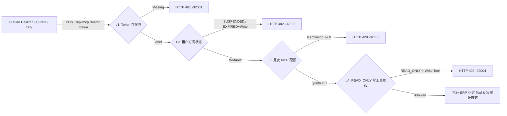

# 03. 核心跨境 ERP 业财引擎与下游 MCP Server 域 (`03-erp-domain-and-mcp`)

## 1. 适用场景声明
当修改或排查以下目录与文件时，**必读本篇**：
- `/src/lib/erpEngine.ts`（业财核算、FBA 泡重计费与 MCP 权限评估纯函数核心）
- `/server.ts` 中的 `POST /api/mcp`（下游 Model Context Protocol JSON-RPC 2.0 端点）
- `/src/components/AmazonOrdersAndListingsView.tsx`
- `/src/components/InventorySupplyChainView.tsx`
- `/src/components/WarehouseInventoryView.tsx`
- `/src/components/FbaShipmentsView.tsx`
- `/src/components/AdvertisingDaypartingView.tsx`
- `/src/components/FinanceAccountingView.tsx`
- `/src/components/McpAndCloudDeployView.tsx`

---

## 2. 第一性原理推导 (First-Principles Derivation)
1. **为什么将业财公式与 MCP 策略抽离到无副作用的 `src/lib/erpEngine.ts`**：
   - 跨境利润核算（营收 − 佣金 − FBA 费 − 仓储 − 广告 − 退款损耗 − 采购与头程 COGS − 站外杂费）和 FBA 泡重公式（$\max(\frac{L \times W \times H}{6000}, W_{\text{gross}})$）属于强确定性数学映射。将其从 React 组件内剥离为纯函数后，前端看板、CSV 导出、边缘 MCP Server 和 50ms 级内存故障注入自检共享同一份数学真理（Single Source of Truth），根绝“大盘算出来 22%、财务表算出来 19%”的口径分裂。
2. **为什么下游 `/api/mcp` 必须执行四层漏斗拦截 (`401 -> 402 -> 429 -> 403`)**：
   - AI Agent（Claude Desktop / Cursor / Dify）具有高频自治调用能力，一旦缺乏刚性边界，可能在夜间耗尽租户配额或用只读令牌误触发 1688 采购单草稿。四层有序校验确保：未认证 (`401`) → 租户停机/过期写锁 (`402`) → 月度配额耗尽 (`429`) → 令牌只读越权 (`403`) 逐级阻断。

---

## 3. 总体架构拓扑与核心数据流

| 业务子域 | 核心计算/流程 | 关键边界保护 |
| --- | --- | --- |
| 利润与结算核算 | `calculateAsinProfit(listing, sku, rate, extraExp)` | `rate <= 0` 回退 `7.2`；`revenue30dUsd === 0` 时净利率归 `0`；`dailySales7d === 0` 时可售天数返回 `999` |
| FBA 泡重与头程计费 | `calculateFbaVolumetricCharge(params)` | 长宽高/毛重/箱数全部 `Math.max(0, x)` 截断；总件数为 `0` 时单件运费安全返回 `0` |
| 多币种实时汇率与领星口径汇总 | `buildUsdRateMapFromExchangeRates` / `calculateLingxingWindowSales` / `calculateLingxingAdSummary` / `calculateLingxingSettlementSummary` | 优先使用领星 MCP 同步的 `ExchangeRateItem[]`（`my_rate` > `rate_org`），兼容 CNY 基准与 USD 倒数报价；默认剔除取消单与换货单 (`isReplacementOrder`)，严格区分有效订单量 (单) 与总销量 (件) |
| 下游 MCP 沙箱 | `evaluateMcpAccess(params)` | 写工具集合严格覆盖 `create_draft_purchase_order`、`adjust_campaign_bid_or_rule`、`sync_from_lingxing_mcp` |

---

## 4. 详细设计方案与代码契约
1. **ASIN 真实净利润数学契约**：
   $$\text{NetProfit}_{\text{USD}} = \text{Rev} - \text{Rev}\cdot r_{\text{ref}} - Q\cdot F_{\text{fba}} - S_{\text{storage}} - A_{\text{ad}} - \text{Rev}\cdot r_{\text{refund}}\cdot 0.85 - Q\cdot\frac{C_{\text{po}} + C_{\text{head}}}{R_{\text{fx}}} - E_{\text{extra}}$$
2. **FBA 体积重计费契约**：
   $$W_{\text{vol}} = \frac{L \cdot W \cdot H}{6000},\quad W_{\text{charge}} = \max(W_{\text{vol}}, W_{\text{gross}})$$
3. **MCP Resource URI 命名空间契约**：
   - 所有对外暴露的资源 URI 必须以 `xcloud://` 为前缀（如 `xcloud://tenant/overview`、`xcloud://inventory/alerts`、`xcloud://finance/profit-summary`）。
4. **领星 MCP 实时汇率 (`EXCHANGE_RATES`) 与 30 天利润汇总 (`PROFIT_SUMMARY`) 契约**：
   - 同步器通过 OpenMCP `search` + `help` 自动发现并拉取领星实时汇率与利润汇总工具，落表至 `erp_domain_records`（`exchangeRates`、`profitSummaries`）；
   - `normalizeLingxingExchangeRates` 自动识别人民币基准报价与美元倒数报价，计算各币种精确 `rateToUsd` 与 `rateToCny`；
   - `calculateLingxingWindowSales` 支持 `excludeReplacement`（默认 `true` 排除换货单）与 `endAtYesterday`（`含今日` / `截至昨日` 完整自然日切换），并将订单量 (`orderCount` · 单) 与销量 (`unitVolume` · 件) 分列输出。

---

## 5. 接口详细文档 (API & Data Contracts)

### `POST /api/mcp` (JSON-RPC 2.0)
- **鉴权要求**：HTTP Header `Authorization: Bearer <X_CLOUD_MCP_TOKEN>`。
- **支持的方法 (`method`)**：
  1. `initialize`：返回 `protocolVersion: "2025-03-26"` 与 `serverInfo.name: "x-cloud-erp-mcp-server"`。
  2. `tools/list`：返回 5 个标准跨境 ERP Tool（3 个只读分析 Tool + 2 个受控写/同步 Tool）。
  3. `resources/list`：返回 3 个 `xcloud://` 协议只读快照资源。
  4. `tools/call`：执行指定 Tool 并返回 `{ content: [{ type: "text", text: "..." }] }`。
- **错误码字典**：
  - `401 / -32001`：缺少 Bearer Token。
  - `402 / -32002`：租户处于 `SUSPENDED` 或 `EXPIRED_READONLY`（执行写工具时）。
  - `429 / -32003`：当月 MCP 调用配额已用尽。
  - `403 / -32004`：`READ_ONLY` 令牌尝试调用受控写/同步工具。

---

## 6. 历史故障与对抗挑刺规则索引 (`scripts/audits/03-erp-domain-and-mcp.audit.ts`)

| 规则 / 测试 ID | 挑刺检查目标 | 历史故障根因与防重契约 |
| --- | --- | --- |
| `ERP-ADV-01` | 校验 `server.ts` 的 `/api/mcp` 完整实现 `401`/`402`/`429`/`403` 四层漏斗拦截，且 `READ_ONLY` 拦截包含 `sync_from_lingxing_mcp` | 防止只读 AI Agent 令牌绕过限制触发上游同步或自动创建 1688 采购草稿 |
| `ERP-ADV-02` | 校验 `server.ts` 中 MCP `resources/list` 全部使用 `xcloud://` URI 前缀 | 防止品牌迁移后遗留旧协议前缀导致下游客户端资源 URI 断链 |
| `ERP-ADV-03` | 校验 `src/lib/erpEngine.ts` 在利润率、ACOS、可售天数与单件运费计算中存在显式除零防线 | 防止新品 0 销量或空箱规引发 `NaN`/`Infinity` 污染前端图表与 CSV 财务底表 |
| `ERP-ADV-04` | 校验 `LingxingMcpConnectorView.tsx` 严禁包含 AWS SigV4 / SP-API `refresh_token` 或 `client_secret` 录入表单 | 坚守“领星 MCP 单一上游数据源”产品决策，杜绝旧式 SP-API 复杂表单回流 |
| `ERP-ADV-05` | 校验 `src/lib/erpEngine.ts` 统一导出 `calculateLingxingReplenishment`、`calculateThreeBasisProfit`、`calculatePricingProfitTrial` 并通过零销量/必断货/零售价内存故障注入 | 保证领星式科学补货三态预警、发货/订单/结算三口径利润与多站点定价试算共享单一计算真理，杜绝跨视图口径打架与除零 `NaN` |
| `ERP-ADV-06` | 校验 `erpEngine.ts` 与 `lingxingMcpSync.ts` 完整导出多币种实时汇率折算、换货单排除及广告/结算 USD 汇总纯函数，并通过 CNY 基准/USD 倒数汇率、换货单剔除、订单量与销量分列及多币种广告费折算内存故障注入 | 防止多站点原币种金额直接相加造成虚高、防止换货单造成 30 天销量与领星前台对不上，确保订单量(单)与销量(件)口径严格区分 |
