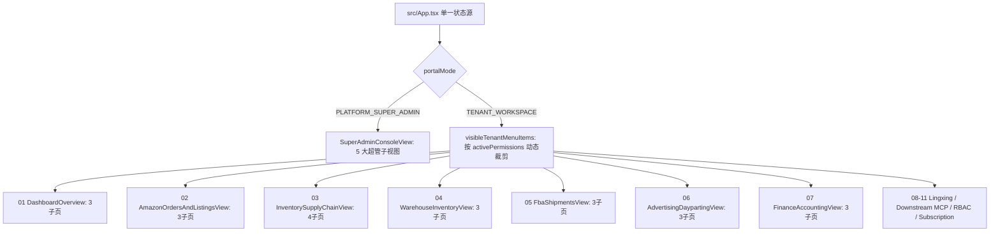

# 04. 前端视图架构、主题系统与状态一致性域 (`04-frontend-ui-and-state`)

## 1. 适用场景声明
当修改或排查以下目录与文件时，**必读本篇**：
- `/src/index.css`（Tailwind CSS v4 入口与暗色模式变体）
- `/src/App.tsx`（双门户状态机、动态 RBAC 菜单渲染与全局视图装配）
- `/src/components/*`（全部 1:1 业务子页面与超管/RBAC 视图组件）
- `/index.html` 与 `/metadata.json`（应用标题、元数据与品牌标识）

---

## 2. 第一性原理推导 (First-Principles Derivation)
1. **为什么 Tailwind CSS v4 必须在 `@import "tailwindcss";` 后声明 `@custom-variant dark`**：
   - Tailwind v4 默认按操作系统 `prefers-color-scheme` 媒体查询切换暗色，若不声明 `@custom-variant dark (&:where(.dark, .dark *));`，点击页内「切换深邃暗色模式」往 `<html>` 挂载 `.dark` 类名将完全失效，造成浅底白字或深底黑字的严重可读性灾难。
2. **为什么禁止在 IFrame 预览环境使用 `window.alert` 与 `window.open`**：
   - 浏览器沙盒 IFrame 会静默拦截阻塞式原生弹窗与不受信任的新窗口跳转，导致用户点击按钮“无任何响应”。一切反馈必须通过页面内非阻塞 Toast / 状态提示栏完成。
3. **为什么采用“零死路由装配校验”与“全仓库品牌脱敏扫描”**：
   - 在拥有 11 大模块、22 个 1:1 业务子页面的大型 ERP 中，极易出现写完组件却忘记挂载到 `App.tsx` 或重构时残留历史参考品牌字眼/个人真实邮箱的问题。通过静态探针固化为硬门禁，实现零人工疏漏。

---

## 3. 总体架构拓扑与核心数据流

| 视觉与交互规范 | 强制标准 |
| --- | --- |
| 容器层级 | 单层扁平化 `1px` 边框 (`border-slate-200 dark:border-slate-800`)，禁止卡片套卡片与装饰性左边框条 |
| 数值对齐 | 所有金额、数量、百分比、SKU、ASIN、订单号强制使用 `font-mono tabular-nums` |
| 顶部导航契约 | 严格三区布局：左区菜单折叠触发器 + 单文本 Wordmark (`X Cloud ERP`) · 中区桌面端 (`>= lg`) 单行门户切换 · 右区单一主操作按钮 |
| 响应式左折叠侧边栏 | `< lg` (移动端/平板) 固定左滑抽屉 (`fixed inset-y-0 left-0 z-50 -translate-x-full` ↔ `translate-x-0`)，支持遮罩点击/Esc 关闭、背景滚动锁定与内置双门户切换；`>= lg` (桌面端) 支持展开态 (`lg:w-64`) 与左折叠图标窄栏 (`lg:w-16`，带原生 `title` 悬浮提示) 自由切换 |
| 打印支持 | FNSKU 条码与外箱箱唛打印采用页内可视化预览 + 原生 `window.print()`，禁止 `window.open` |

---

## 4. 详细设计方案与代码契约
1. **权限失效自动回退契约 (`effectiveTenantTab`)**：
   - 当租户管理员在 RBAC 中心切换到“北美运营专员”或取消某角色模块权限时，`effectiveTenantTab` 自动校验当前 Tab 是否仍在 `visibleTenantMenuItems` 中，若无权访问立即无缝回退至首个合法菜单，绝不出现白屏或残留无权界面。
2. **数据完整性引用契约**：
   - 初始演示数据中，所有 `INITIAL_LISTINGS` 的 `localSkuCode` 必须命中 `INITIAL_LOCAL_SKUS`，`shopId` 必须命中 `INITIAL_SHOPS`；`TENANT_ADMIN` 角色必须覆盖 `ALL_PERMISSIONS_TREE` 全部权限码。
3. **跨端左折叠侧边栏状态解耦契约 (`mobileSidebarOpen` / `desktopSidebarCollapsed`)**：
   - 移动端抽屉开关 (`mobileSidebarOpen`) 与桌面端窄栏折叠状态 (`desktopSidebarCollapsed`) 严格解耦：即使桌面端处于 `lg:w-16` 折叠态，缩小至 `< lg` 打开抽屉时依然以 `w-72 max-w-[85vw]` 完整展示租户/角色上下文与菜单文字，切换菜单或租户后自动收起抽屉。

---

## 5. 接口详细文档 (API & Data Contracts)
- **组件 Props 契约规范**：
  - 所有含写操作的租户业务组件必须同时接收 `isReadOnlyExpired: boolean` 以及对应细粒度按钮权限布尔值（如 `canEditPrice`、`canCreatePo`、`canApprovePo`、`canReceivePo`、`canExecuteBom`、`canCountAdjust`、`canTransfer`、`canCreateFba`、`canPrintLabel`、`canEditBid`、`canNegateTerm`、`canExportCsv`、`canReconcile`、`canWriteMcp`）。
  - 含采购成本或毛利展示的组件必须接收 `hidePurchaseCost: boolean` 并在为 `true` 时输出 `***` 脱敏占位符。

---

## 6. 历史故障与对抗挑刺规则索引 (`scripts/audits/04-frontend-ui-and-state.audit.ts`)

| 规则 / 测试 ID | 挑刺检查目标 | 历史故障根因与防重契约 |
| --- | --- | --- |
| `UI-ADV-01` | 校验 `src/index.css` 包含 `@import "tailwindcss";` 且紧随声明 `@custom-variant dark` | 防止 Tailwind v4 类名暗色切换失效导致黑白主题对比度崩坏 |
| `UI-ADV-02` | 扫描 `src/`、`server.ts`、`index.html`、`metadata.json` 严禁残留已废弃品牌名、旧前缀或个人真实邮箱 | 防止参考代码重构后发生品牌词回流或个人隐私信息外泄 |
| `UI-ADV-03` | 扫描 `src/` 严禁出现 `window.alert(` 或 `window.open(` 调用 | 防止 IFrame 沙盒拦截原生浏览器对话框导致用户操作无反馈 |
| `UI-ADV-04` | 校验 `src/App.tsx` 完整引入并挂载全部 13 个核心双门户与 1:1 业务视图组件 | 防止新建子页面成为“孤岛死代码”未被主路由装配 |
| `UI-ADV-05` | 校验 `src/App.tsx` 同时具备移动端左折叠抽屉 (`mobileSidebarOpen`, `-translate-x-full`, `lg:translate-x-0`) 与桌面端左折叠图标栏 (`desktopSidebarCollapsed`, `lg:w-16`) | 防止固定 `w-64` 侧边栏在手机/窄屏视口挤压主内容区导致白屏或横向截断，同时保障桌面宽表场景可一键收起导航释放视口宽度 |
| `UI-ADV-06` | 校验 `src/App.tsx` 挂载 `<ProductPerformanceView>` 与 `<OperationsToolsView>`，且 `DashboardOverview.tsx` 包含 `GLOBAL_SITE_CLOCKS` 与 `STOCKOUT_CERTAIN` 驾驶舱契约 | 防止领星式「统计 · 产品表现」「工具 · 预警/试算/审批」及驾驶舱全球站点时钟/三态断货预警发生路由退化或漏挂 |
| `UI-ADV-07` | 校验 `src/components/TablePagination.tsx` 导出 `TablePagination` / `useTablePagination`，且全部 10 个核心 ERP 数据视图接入 `<TablePagination>` 分页查看 | 防止全量分页入库后列表硬编码截断（如 `.slice(0, 60)`）或一次性渲染数百上千行导致卡顿与记录无法翻阅 |
